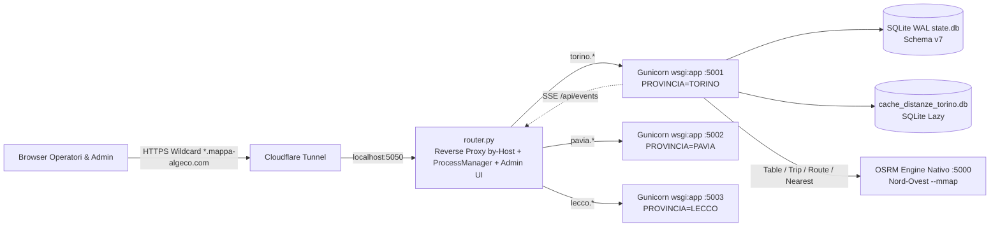

# Mappa Algeco — Gestionale Multi-Tenant per Sostituzione Contatori

[](https://github.com/algecopower/mappa-algeco/actions/workflows/test.yml)


-003B57.svg)


Piattaforma web full-stack **multi-provincia** sviluppata in Python/Flask per pianificare, instradare e coordinare le squadre tecniche impegnate nella sostituzione massiva di contatori elettrici (commesse E-Distribuzione).

Progettata ed evoluta per gestire operatività reale su più territori isolati (`TORINO`, `PAVIA`, `LECCO`, estendibili dinamicamente via pannello admin), unisce **ottimizzazione geografica e temporale dei percorsi (OSRM + DBSCAN)**, **persistenza SQLite locale ad alta affidabilità**, **aggiornamenti real-time via Server-Sent Events** e una **suite multicanale integrata** (PDF parser, Email/PEC SMTP+IMAP, SMS Gateway e WhatsApp).

---

## Obiettivo e valore ingegneristico

La sostituzione sul campo di migliaia di contatori richiede di risolvere contemporaneamente tre problemi operativi:

1. **Pianificazione territoriale e routing vincolato:** raggruppare i punti in macro-zone omogenee e calcolare giri giornalieri realistici rispettando gli **appuntamenti con i clienti come ancore temporali**, lo snapping dell'accesso stradale corretto (*access point*) e le geometrie viarie reali.
2. **Integrità dei dati in presenza di flussi eterogenei:** far convivere modifiche rapide da interfaccia Web, report installazioni E-Distribuzione (*BOXBEAT*), distinte PDF, import manuali/automatici da fogli esterni ed esportazioni selettive verso sistemi terzi senza perdita o sovrascrittura di dati.
3. **Multi-tenancy leggera e gestibile su singola VPS:** servire più sedi provinciali completamente isolate (processo, DB, cache, utenti, SMTP/SMS) dietro un singolo reverse proxy Python e Cloudflare Tunnel, gestibile self-serve da dashboard web.

---

## Architettura del sistema



### Scelte architetturali principali

- **Multi-tenancy process-isolated (`router.py` + `gunicorn`):** ogni provincia gira in un proprio worker Gunicorn (`1` worker `gthread` × `32` thread per mantenere in RAM un singolo dataset ed evitare duplicazione di memoria, gestendo decine di stream SSE long-lived concorrenti). [`router.py`](router.py) smista il traffico per header `Host`, monitora e riavvia i figli e offre la console centralizzata su `admin.*`.
- **Dual-Speed Sync Engine (Patch in-place ~50 ms vs Full Sync):** quando una modifica riguarda campi non strutturali (`SOFT_FIELDS_DB`: telefono, email, sigillo, matricola, note senza appuntamento), [`moduli/mappa_data_patcher.py`](moduli/mappa_data_patcher.py) aggiorna selettivamente `mappa_data.json` in ~50 ms e notifica i client connessi via **SSE**. Solo i cambi strutturali (`DATA PIAN`, operatore, coordinate, appuntamenti `APP`) rilanciano la pipeline `data_loader → distanze → zone → mappa`.
- **SQLite-First con Merge Sicuro & Outbox:** dal 21/05/2026 il DB SQLite per provincia (`PK (eneltel_key, lcl)`, 18 tabelle) è l'unica fonte di verità per le scritture ([`DB_LOCALE_README.md`](DB_LOCALE_README.md)). Gli aggiornamenti esterni arrivano via import Excel o cron orario read-only ([`moduli/auto_import.py`](moduli/auto_import.py)) protetti dalla politica *"vince il più recente per riga"* e deduplicati tramite SHA-256 sui CRC dello ZIP XLSX; le modifiche locali possono essere esportate via **Outbox** compatto (`POD` + celle modificate evidenziate).

---

## Funzionalità implementate

### Mappa, Routing & Pianificazione
- **Clustering DBSCAN e Viste Multiple:** raggruppamento automatico dei comuni in zone operative ([`moduli/zone_geografiche.py`](moduli/zone_geografiche.py)), vista per zona, per comune, dettaglio giornaliero e percorso singolo/multi-operatore.
- **TSP OSRM con Ancore Temporali & Access Points:** ordinamento tramite OSRM Trip API ([`moduli/percorso.py`](moduli/percorso.py)) rispettando le finestre orarie degli appuntamenti, snapping su strada tramite matching del nome via su `/nearest` ([`moduli/access_points.py`](moduli/access_points.py)) e cache persistente lazy in SQLite ([`moduli/cache.py`](moduli/cache.py)).
- **Modalità Pianificazione sulla Mappa:** selezione singola, a rettangolo o a lasso libero con filtri multipli e assegnazione massiva di data e operatore.
- **Ricerca Avanzata Multi-POD / Multi-Eneltel, Pin Multipli & Stampa HD:** supporto a liste di codici incollate in bulk, pinning simultaneo con barra flottante, toggle badge orari e anteprima di stampa con etichette anti-sovrapposizione.

### Operatività, Documenti & Comunicazioni
- **Vista Excel Filone (`/filone`):** griglia tabellare multi-tab indipendente sincronizzata in real-time con `state.db`, con editing inline e import/aggiunta righe.
- **PDF E-Distribuzione (`/distinte`):** parser PDF (`pdfplumber`) per *DistintaBase* e *Moduli Maxy*, rilevamento scostamenti rispetto al DB, messaggi WhatsApp precompilati e **invio Email/SMS in bulk**.
- **SMS Gateway Integrato ([`tools/README_SMS_GATEWAY.md`](tools/README_SMS_GATEWAY.md)):** invio SMS direttamente da smartphone Android aziendale (app open source `capcom6/android-sms-gateway`, modalità locale o cloud) o webhook HTTP con normalizzazione E.164, contatore **GSM-7 / UCS-2** e pausa anti-flood.
- **Webmail SMTP/IMAP (`/mail`):** client email completo archiviato in SQLite (`inbox`, `sent`, `drafts`, `scheduled`, `archive`, `trash`), sync IMAP, coda invii schedulati, categorizzazione intelligente e autocompletamento unificato.
- **Gestione Lettere & PEC Aziende (`/lettere`):** generazione fogli Excel multi-tab con fasce orarie calcolate sui percorsi (`genera_excel_lettere.py`), classificazione euristica **Aziende / Enti / Condomini vs Privati** ([`moduli/rilevamento_aziende.py`](moduli/rilevamento_aziende.py)) con override manuale e invio bulk PEC/Email/SMS.
- **Comuni & ZTL (`/comuni`), Modelli Centralizzati (`/templates`), Agenda & Analytics (`/calendario`, `/appuntamenti`, `/dashboard`, `/report`):** gestione ZTL e contatti comunali, libreria condivisa di template/snippet, bacheca promemoria automatici, workflow giornaliero e dashboard KPI.

### Sicurezza & Amministrazione
- **Autenticazione Argon2id (`moduli/auth.py`):** hashing `argon2-cffi` con upgrade trasparente da hash PBKDF2 legacy, RBAC (`admin` / `user`), isolamento per provincia ad ogni richiesta e rate-limit login (5 tentativi → blocco 60 s).
- **Hardening Sessioni & Mutazioni:** cookie `HttpOnly` / `SameSite=Lax` / `Secure` (in produzione), `SESSION_COOKIE_DOMAIN` condiviso tra sottodomini, protezione CSRF double-submit + verifica `Origin`/`Referer`.
- **Dashboard Admin (`admin.*`):** gestione ciclo di vita dei worker, **Wizard di configurazione 3-step**, CRUD colonne del filone, import/export/Outbox Excel, gestione utenti, configurazione SMTP/SMS e visualizzatore log `journalctl` in tempo reale.

---

## Stack tecnologico

| Layer | Tecnologie |
|---|---|
| **Backend & WSGI** | Python 3.12, Flask (`14` Blueprint in `routes/` + `router.py`), Gunicorn (`gthread`) |
| **Database & Cache** | SQLite (WAL, Schema v7, PK composta), cache distanze SQLite lazy |
| **Routing & Data Science** | OSRM (`v5.27.1` nativo `--mmap`), `pandas`, `scikit-learn` (DBSCAN), `openpyxl`, `xlrd`, `pdfplumber` |
| **Frontend** | Vanilla JS, HTML/CSS custom con tema chiaro/scuro persistente, Leaflet.js, Server-Sent Events |
| **Comunicazioni** | SMTP (`465`/`587` con retry e IMAP `Sent`), IMAP sync, Android SMS Gateway / Webhook |
| **Sicurezza & Infra** | `argon2-cffi`, CSRF & Origin check, `systemd`, Cron, Cloudflare Tunnel wildcard |
| **Qualità & CI** | `pytest` (32 file di test isolati con DB temporaneo), `ruff`, GitHub Actions |

---

## Quickstart locale (sviluppo e test)

```bash
# 1. Clona il repository e crea l'ambiente virtuale
git clone git@github.com:algecopower/mappa-algeco.git
cd mappa-algeco
python3.12 -m venv venv
source venv/bin/activate
pip install -r requirements-dev.txt   # include requirements.txt + pytest + ruff

# 2. Crea il primo utente locale (users.json è ignorato da git)
python gestione_utenti.py --crea dev.admin --password PasswordSicura1!
python -c "from moduli.auth import set_user_role; set_user_role('dev.admin', 'admin')"

# 3. Avvia una provincia standalone (anche senza OSRM locale in dev)
python server.py --torino --skip-osrm-check

# Oppure avvia l'intera architettura multi-tenant (router + backend Gunicorn)
ROUTER_PORT=5050 python router.py
```

### Lint e Suite di Test

La suite usa la fixture `db_isolato` ([`tests/conftest.py`](tests/conftest.py)) che indirizza `state.db` su file temporanei, evitando qualsiasi impatto sui dati di produzione.

```bash
# Lint configurato in pyproject.toml
python -m ruff check .

# Test completi
python -m pytest -v
```

Il workflow CI in [`.github/workflows/test.yml`](.github/workflows/test.yml) esegue automaticamente `ruff check .` e `pytest -v` ad ogni push e pull request su `main`.

---

## Struttura del repository

```
├── server.py               # App Flask per provincia, auth/CSRF, SSE, sync loop & API admin DB
├── router.py               # Reverse proxy multi-tenant by-Host, ProcessManager & admin UI
├── wsgi.py / gunicorn.conf.py
├── config.py               # Caricamento data/provinces.json + override settings.json
├── gestione_utenti.py      # CLI gestione utenti in users.json
├── genera_excel_lettere.py # Generazione Excel multi-foglio per spedizioni lettere
├── moduli/                 # 31 moduli di dominio (DB, OSRM, DBSCAN, importer, outbox, mail, SMS, PDF...)
├── routes/                 # 14 blueprint Flask REST + viste HTML
├── templates/              # 12 template Jinja2 per-provincia
├── templates_router/       # Dashboard amministrazione multi-provincia (admin.html)
├── static/                 # JS/CSS/asset condivisi
├── tools/                  # 9 CLI operative (dump_db, auto_import_filone, archive/cleanup, benchmark percorsi)
├── deploy/                 # Template systemd, timer notturno, cron auto-import e cloudflared
└── tests/                  # Suite pytest (32 moduli test_*.py + fixture)
```

---

## Indice della documentazione

| Documento | Contenuto |
|---|---|
| [`DOCUMENTAZIONE.md`](DOCUMENTAZIONE.md) | Riferimento tecnico e funzionale completo: architettura, moduli, API REST, configurazione e algoritmi |
| [`DB_LOCALE_README.md`](DB_LOCALE_README.md) | Architettura SQLite WAL (Schema v7), flusso patch in-place vs full-sync, Outbox e Auto-Import |
| [`GUIDA_UTILIZZO.md`](GUIDA_UTILIZZO.md) | Manuale operativo passo-passo per tutte le viste web e le funzioni della mappa |
| [`GUIDA_ACCOUNT.md`](GUIDA_ACCOUNT.md) | Gestione utenti Web & CLI, ruoli `admin`/`user`, Argon2id, sessioni cross-subdomain e CSRF |
| [`GUIDA_DEPLOY_VPS.md`](GUIDA_DEPLOY_VPS.md) | Deploy completo su VPS Ubuntu (OSRM nativo `--mmap`, Gunicorn/router, systemd, cron) |
| [`GUIDA_CLOUDFLARE.md`](GUIDA_CLOUDFLARE.md) | Configurazione Cloudflare Tunnel wildcard (`*.mappa-algeco.com` → `:5050`) |
| [`deploy/README.md`](deploy/README.md) | Schema servizi systemd in produzione, procedura self-serve nuove province e rollback |
| [`tools/README_SMS_GATEWAY.md`](tools/README_SMS_GATEWAY.md) | Configurazione e uso di SMS Gateway for Android / Webhook in Distinte e Lettere |
| [`AGENTS.md`](AGENTS.md) | Convenzioni di sviluppo, regole di stile e testing del repository |
